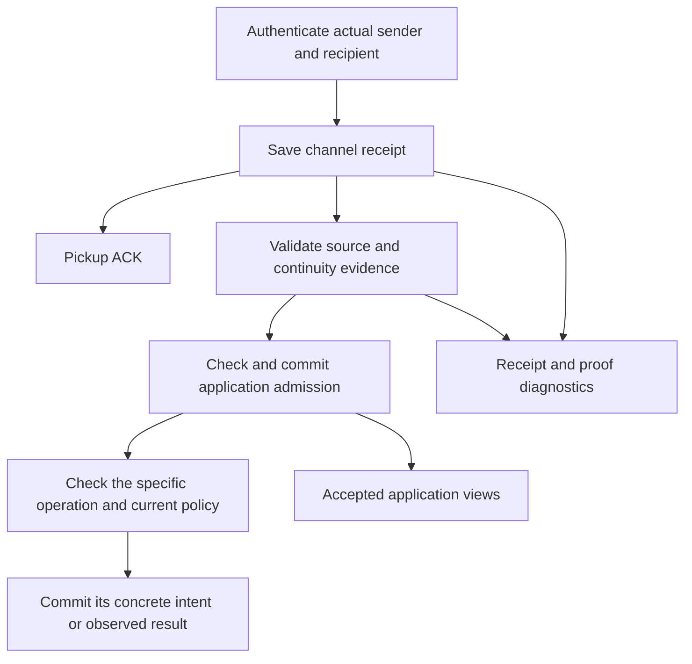

# Channels, addresses and continuity

<!-- suite-navigation:start -->
[Suite guide](README.md)
<!-- suite-navigation:end -->

Status: **version 5**. The channel layer of the vault is code: the channel
pair and its order in [ids.ts](../../packages/vault/src/ids.ts); the payloads
of `did.created`, `did.disclosed`, `did.rotationSelected`,
`message.admitted`, `channel.blocked` and `contact.channelsSet` in
[schema.ts](../../packages/vault/src/schema.ts); what each receipt, proof and
decision establishes, the continuity read over them, admission, invitations,
contact views and the succession of local addresses in the folds
[`@estoc/vault`](../../packages/vault/README.md) lists; and the receive gate,
resolution, preparation, rotation and the private-address policy in the
procedures [`@estoc/agent-core`](../../packages/agent-core/README.md) lists.
Each module states in its leading comment the rule it implements, and its
tests sit beside it. The
[`@estoc/from-prior` package](../../packages/from-prior/README.md) owns proof
semantics and the [`@estoc/continuity` package](../../packages/continuity/README.md)
owns graph semantics. This document keeps what that code cannot state about
itself: what a channel, a link, a contact and an address are, which DIDs a
channel may use and how they resolve, and the boundaries of admission,
continuity and denial across replicas and restores. Capitalized requirement
words have their BCP 14 meanings.

## 1. Model

A **channel** is the fixed ordered pair `(localDid, peerDid)` of distinct
canonical `did:peer:4` communication DIDs, viewed from one vault. `(A, B)`
and `(B, A)` are different vault-local views; receiving from B at A and
sending from A to B use the same channel, written `C(A, B)`. Each message
stays in the channel it was observed or sent in, with its sender, recipient,
authenticated keys and exact immutable document evidence.

A **continuity link** is a derived replacement of exactly one endpoint in the
context of one channel. The fold computes it from received proofs, resolution
evidence and local rotation decisions; no link event is stored, and its
authority is scoped to each channel context.

A **contact** organizes selected channels with local names and preferences.
Its edits affect presentation and send choices, not message identity or
protocol authority. Channels and continuity exist independently of contacts,
and an unassigned channel remains usable.

Receipt needs no invitation state, contact or continuity history. Anonymous
input has no channel or application execution. Each later operation checks
its own evidence and policy in the module that owns it.

## 2. Channel identity

Both endpoints are canonical numalgo-4 short forms, compared byte for byte in
each role; equal endpoints are invalid. A receipt derives its pair from the
local key's DID and the authenticated sender, an outbound intent from its
sender DID entity and canonical recipient, and a source-based fact from the
message it references. Missing endpoint evidence leaves that projection
pending: contact membership, another observation or a shared key cannot
supply it.

Replacing either DID creates another channel. Changing a numalgo-4 encoded
document yields another DID, and shared keys or services do not alias
distinct DIDs. A selector, such as contact membership or a denial, stores the
two canonical DID strings and is checked offline; a missing document or local
entity leaves its evidence unresolved and grants no authority.

## 3. Addresses

A local address is made for one of two uses, fixed in its creation. An
**entry** is an address handed out, as an invitation or a direct DID, and
whoever holds it may write to it. A **private branch** is the succession of
addresses one relationship moves through once it leaves an entry: its
**start** is the first address toward one peer, bound to the peer's address
the usable history led back to when it was made, and each **next** replaces
the start or a next in the same branch. Only an entry is disclosed; an
address of a branch is its peer's alone.

A successor is derived, not chosen, so that replicas deciding one rotation
apart arrive at one entity on the predecessor's route and record two records
of one intent rather than a fork. The recipe is
[succession.ts](../../packages/vault/src/succession.ts), and which records
are one intent is [rotation-policy.ts](../../packages/vault/src/rotation-policy.ts).
The binding of a start is what the deciding vault could see. Two replicas
that see different fragments of the peer's history may bind to different
addresses and so make different starts; once the evidence that relates them
merges, continuity shows the competition as a conflict, and nothing settles
it by arrival. Making a branch address serve another relationship, or
splitting one a peer reused, is not provided.

Branches exist for privacy: [the private-address policy](../../packages/agent-core/src/privacy.ts)
moves a relationship off a disclosed entry once the peer's first application
input there is established.

### Invitations and discovery

OOB, QR, a directory, a file, NFC or manual exchange discloses an ordinary
address, and reusable discovery SHOULD use an entry. An invitation is an
address handed out, not a token: whoever holds it writes in a channel of
their own, a receipt under it is an ordinary receipt that needs and grants no
invitation state, and an OOB ID supplies `pthid`, not channel identity. When
an invitation may still be handed out is
[the invitation fold](../../packages/vault/src/fold/invitations.ts).

### Sending

Before an intent is committed, one exact channel that takes new work is
selected, explicitly or through the contact's send choices, whose default is
the unique verified head ([the contact view](../../packages/vault/src/fold/views.ts)).
An explicit address choice may start a new channel without a handshake. Any
supported application protocol may be the first message, with no rendezvous
wrapper, wire contact field or preliminary handshake; when no content is
ready, the first message is an ordinary Trust Ping. An existing intent keeps
its channel.

## 4. DIDs and their resolution

Both endpoints of every application channel, and the predecessor and
successor of every continuity link, are `did:peer:4`, for public and private
disclosure alike. An unsupported sender fails the receive gate, an
unsupported recipient cannot form an outbound intent, and a proof whose
issuer is unsupported is invalid for continuity without invalidating an
otherwise authenticated carrier. A local DID is derived from the seed with a
fixed key-agreement and authentication method and one DIDComm service
([identity.ts](../../packages/vault/src/identity.ts)); a peer's document is
retained in the one form [peer-document.ts](../../packages/vault/src/peer-document.ts)
gives it, whichever spelling the peer presents.

A sender uses its long form in a channel context until an admitted
observation there shows the peer has written to that address, and a
successor carries its frozen `from_prior` until then
([prepare.ts](../../packages/agent-core/src/prepare.ts)). Confirmation in an
unrelated channel that shares the address does not count, and a committed
package stays byte-identical after confirmation.

### Resolution

A peer's `did:peer:4` resolves locally, from its validated long form or a
retained long form matching its short form, and starts no network lookup. A
missing long form leaves preparation pending and is not evidence of a key
change; an unknown sender short form without its long form cannot
authenticate. Each receipt and each package retains the exact immutable
document it used as its own `peer.resolved` evidence, and another document
cannot substitute for those bytes
([resolver.ts](../../packages/agent-core/src/resolver.ts),
[evidence.ts](../../packages/agent-core/src/evidence.ts)).

The channel method restriction does not apply to mediator or routing DIDs. A
mediator may use `did:web`; resolving it creates no local DID and makes it no
channel peer. A Web resolver used by a client or a mediator MUST be
constrained against SSRF, DNS rebinding, redirects, unbounded responses and
DID mismatch, with a bounded timeout, and a fetch its policy forbids is a
definitive failure that MUST NOT fall back to an unrestricted one. The
presented Web DID string is the identity: the document's `id` MUST match it
byte for byte, whatever URL or DNS processing the fetch went through. A
mediator lookup failure grants no dispatch authority and does not show that a
channel peer's key changed. The client's resolver is
[resolver.ts](../../packages/agent-core/src/resolver.ts); the mediator's
policy is in [its README](../../mediator/README.md).

## 5. Continuity

The vault projects its retained proof evidence and local rotation decisions
into `@estoc/continuity` and implements no second graph. What each receipt,
carrier and decision establishes on its own is
[fold/channels.ts](../../packages/vault/src/fold/channels.ts); the host's
reading of the model, each record's status, which channels take no new work
and the witness that confirms an address, is
[fold/continuity.ts](../../packages/vault/src/fold/continuity.ts). Proof
verification is local and appends no events.

A verified carrier `M` addressed to local `A`, whose proof names issuer `B0`
and whose authenticated sender is `B1`, yields the peer link
`C(A, B0) -> C(A, B1)`. A decision from local `A0` toward peer `B` with
successor `A1` yields the local link `C(A0, B) -> C(A1, B)`, and at one pair
a local and a peer link join to `C(A1, B1)`. Competing successors for one
endpoint in one context, cycles and contradictory identity evidence are
conflicts the package exposes, and no operation clears them. A verified
replacement ends new work from and to the replaced endpoint in its context,
and in no unrelated channel that shares the DID.

Continuity relates channels and merges nothing: another channel has another
logical input and execution, even for an equal wire ID and content, as
[delivery](distributed-delivery.md#observation-ids-and-vectors) derives them.

A local rotation is the saved decision `did.rotationSelected`, committed
together with or after the successor's creation and before any intent or
disclosure that depends on it, its proof signed by the predecessor's
authentication key. A pair has one
rotation intent in its context, which several records may support: two
replicas deciding it apart, or one deciding it again over a restored snapshot.
A prepared message carries the proof of one of that intent's records. The
procedure is [rotate.ts](../../packages/agent-core/src/rotate.ts).

## 6. Application admission

`message.in` records an authenticated observation, not permission to apply
it. Before a receipt contributes accepted chat, profile values, an incoming
ACK, Report Problem correlation, address confirmation or a new input-derived
operation, `message.admitted` is committed for that exact observation. It is
a trusted runtime's local acceptance decision: not a cached verification
result, a handler result or permission to send, and not a proof of what
another disconnected runtime knew. Admission of one duplicate lends no
authority to another duplicate's headers or authentication, and pickup ACK
only removes a transport delivery. When an admission is effective and what
stands against a new one is
[admission/model.ts](../../packages/vault/src/admission/model.ts); the pass
that records the admissions owed is
[admission/record.ts](../../packages/vault/src/admission/record.ts), and a
fold or replay appends none.

### Merge, restore and disconnected replicas

Merge unions events by CID under the
[event identity contract](event-store.md#invariants), and admissions are
imported with their exact sources and proof evidence, so import order does
not change their meaning: once the same union is available, every reader
derives the same admitted history and the same restrictions. A late
duplicate without its own admission cannot extend an admitted message's
receipt timing or profile content, and a late unadmitted old-peer duplicate
cannot create an intent conflict.

Disconnected histories share no physical receive order, so the earliest
observation in canonical event order is not a rotation cutoff. An admission
one history made before it learned a rotation remains historical evidence
after merge; another history's refusal cannot undo it or a reply already
sent, and an unadmitted old-peer source is not processed after merge.

Replicas of one arrangement each admit against the history they hold.
[Automatic-output selection](distributed-delivery.md#automatic-effects)
decides which replica answers a live input; it does not synchronize their
rotation knowledge. Stopping every replica as soon as one knows a rotation
would need coordination, or a halt while freshness cannot be established,
and offline processing cannot promise it. Neither mediator fan-out nor
deterministic event ordering provides it.

A restore from a snapshot that omits a rotation can lose that restriction. A
fresh author, a seed or an admission event is not an anti-rollback
mechanism: recover newer history when it is available, do not treat an old
address as a guaranteed repair channel, and do not bypass a known
replacement by hand. A deliberate new relationship from an unrelated local
DID forms a new context that inherits no prior conversation authority; a
verified local successor stays in the old context and under its
restrictions.

## 7. Denial and contacts

`channel.blocked` is a permanent local denial of one channel and, when it
includes successors, of the channel's verified successors, through paths a
continuity conflict masks too; that deny-only traversal grants no continuity
or operation authority. Denial stops new admission and new work in the
channel. It does not stop authenticated receipt or pickup ACK, does not
become a global block of a DID, and does not withdraw an effective admission
or its ACK evidence.

A contact is created with a non-empty selection of complete channels in one
batch, possibly before any receipt or peer resolution, so a discovered peer
DID needs a local-DID choice first. Two channels that share a peer DID at
different local addresses stay separately selectable. A product's "delete
and block" appends denials for the concrete channels it chose
([contact-commands.ts](../../packages/vault/src/contact-commands.ts)), and
later membership changes neither widen nor remove them. What a contact shows,
and where a new send from it may go, is
[the contact view](../../packages/vault/src/fold/views.ts).

## 8. Privacy and interoperability

Channels use DIDComm Messaging 2.1 with Out-of-Band 2.0, Trust Ping 2.0,
Empty Message 1.0, Report Problem 2.0 and Routing 2.0, over Peer DID
numalgo 4 and RFC 8785. Peers receive ordinary DIDComm messages, with no
contact ID, replica ID or Estoc handshake. Entries and branches are
disclosure policy, not message schemas or receipt permissions: a shared
address can correlate traffic, and a private branch reduces that reuse.
Continuity holds in exact channel contexts along role-preserving paths and
transfers no authority through display membership. A peer's reuse of one
wire ID across channels is not deduplicated, and channel-local processing
promises no exactly-once business execution.
